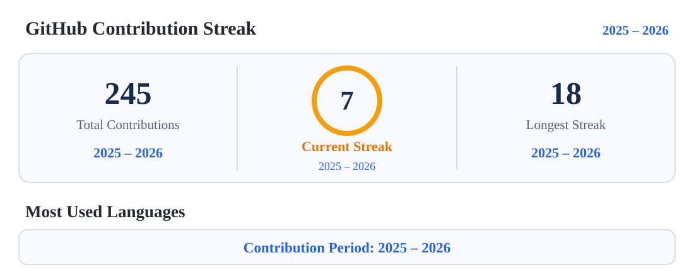

# Hi 👋, I'm Prasad

### 🚀 Aspiring Python Developer | AI & Data Science Enthusiast

🌱 Learning Python, FastAPI, Backend Development and Git & GitHub.

---

### 👨‍💻 About Me

- 🔭 Building projects using Python and Flutter
- 🌱 Currently learning Backend Development with FastAPI
- 💡 Interested in Artificial Intelligence and Data Science
- 💻 Enjoy developing applications and learning new technologies
- 🎯 My goal is to become a skilled Python Developer

---

### 🛠️ Tech Stack & Tools

**Languages**

  

**Frameworks & Development**

  

**Database & Tools**

  

---

### 🚀 Featured Projects

| Project | Description | Technology |
|---|---|---|
| Student Skill Development & Learning Portal | A web application for student learning and skill development | Python, FastAPI |
| Career App | An application to explore career opportunities | Flutter, Dart |
| Tic Tac Toe Game | A two-player game application | Flutter, Java |

---

### 📊 GitHub Statistics

  
  

---

<svg xmlns="http://www.w3.org/2000/svg"
     width="1200" height="530" viewBox="0 0 1200 530">

  <rect width="1200" height="530" fill="#ffffff"/>

  <!-- Heading -->
  <text x="50" y="70" font-size="32"
        font-weight="bold" fill="#24292f">
### 🔥 GitHub Contribution Streak

    📊 Most Used Languages
  </text>

  <rect x="40" y="415" width="1120" height="90"
        rx="18" fill="#f8faff" stroke="#d8dee9" stroke-width="2"/>

  <text x="600" y="470" text-anchor="middle"
        font-size="28" font-weight="bold" fill="#2563eb">
    2025 – 2026
  </text>

</svg>

  

  ⭐ Thanks for visiting my profile! Keep Learning, Keep Building!

